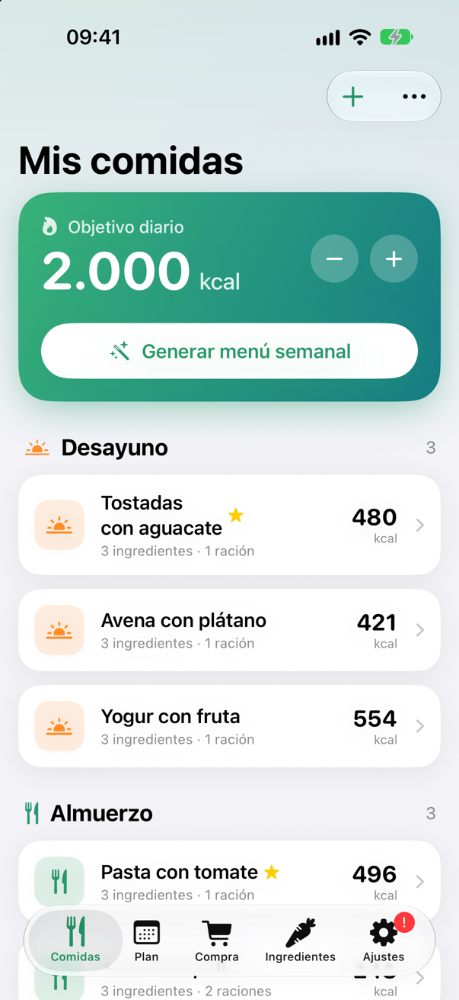
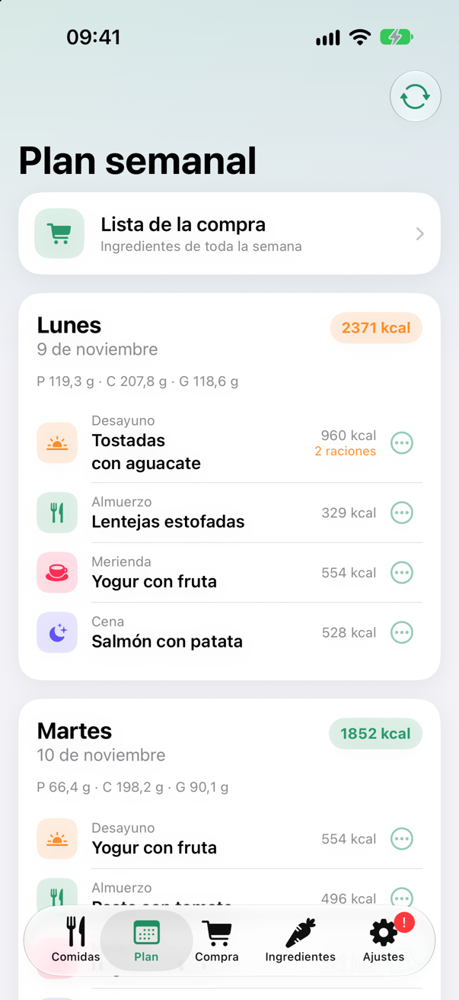
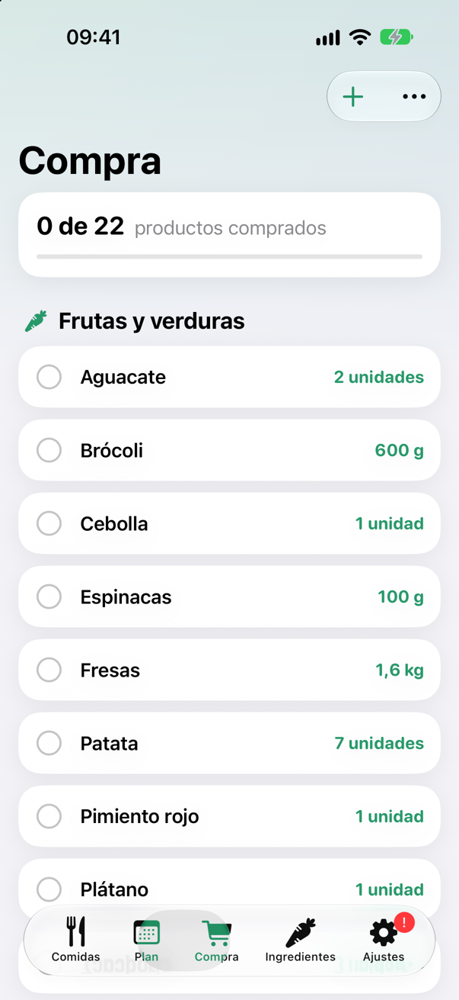
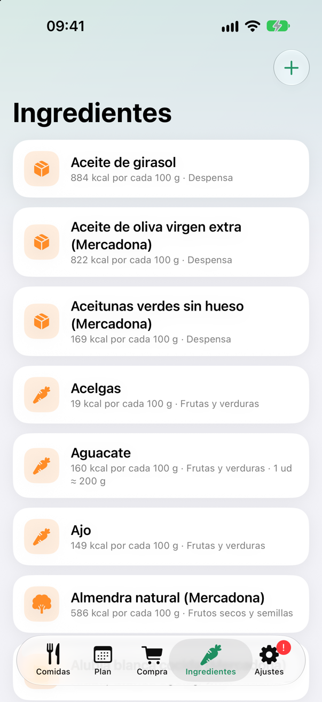

# AppComida

**Planificador de comidas para iPhone:** genera el menú de la semana ajustado a tu objetivo de calorías y te da la lista de la compra con las cantidades exactas. Hecho con **SwiftUI**, sin dependencias externas, con los datos guardados en el propio dispositivo (sin cuentas ni servidores).

<p align="center">
  
  
  
  
</p>

## Qué hace

- **Genera el menú semanal** (desayuno, almuerzo, merienda y cena) cerca del objetivo calórico diario. Cada generación es distinta y evita repetir comidas mientras haya alternativas.
- **Raciones por toma:** cada receta indica cuántas raciones se ponen en el menú cada vez que sale; el generador las usa en las calorías del día y en la compra.
- **Ingredientes variables:** una receta puede tener grupos de opciones (por ejemplo, tortitas con un untado a elegir). Cada opción puede ser un ingrediente o una combinación (*jamón + queso*, o solo *chocolate*). Al generar el menú se elige una opción cada día, repartidas a lo largo de la semana, y las calorías, los macronutrientes y la lista de la compra cuentan la opción elegida.
- **Lo puedes ajustar a mano:** cambiar cualquier comida, comer media ración o dos, y **bloquear** las que te gustan para que se conserven al regenerar.
- **Lista de la compra automática:** suma los ingredientes de toda la semana según las raciones, los muestra en unidades ("2 aguacates") o en kg/g, y los agrupa por secciones del supermercado. Permite añadir productos a mano, marcar "ya lo tengo en casa" y compartirla como texto.
- **Catálogo de ingredientes** con calorías, macronutrientes y peso por unidad. Las calorías y los macronutrientes de cada receta se calculan solos.
- **Recetas:** favoritas, duplicar, búsqueda por nombre y pasos de preparación.
- **Copias de seguridad en JSON:** al importar se puede *combinar* con tus datos (sin perder nada) o *reemplazar*; si algo falla, se restauran los datos anteriores.
- **Recordatorio semanal** mediante notificación local.

## Aspectos técnicos

El proyecto está pensado para ser fácil de mantener y de probar, siguiendo los principios SOLID:

- **Lógica separada de la interfaz.** Generador de menús, lista de la compra, cálculo de recetas, validación y copias de seguridad son funciones puras, sin SwiftUI ni acceso a disco.
- **Inversión de dependencias.** `AppViewModel` recibe el almacén, el generador de menús y los recordatorios **por protocolo**; en las pruebas se sustituyen por versiones falsas (almacén en memoria, recordatorios simulados).
- **Interfaces pequeñas.** La persistencia se divide en un protocolo por tipo de dato (`MealRepository`, `PlanRepository`…) en lugar de uno enorme.
- **Abierto/cerrado.** `SearchableSelectionList` es una lista genérica con búsqueda reutilizada para elegir ingredientes y comidas.
- **Datos compatibles hacia atrás.** Los modelos `Codable` leen copias guardadas por versiones anteriores y un archivo dañado se aparta (`.corrupt`) en vez de sobrescribirse.
- **Algoritmo del menú.** Para cada día evalúa las combinaciones de una comida por franja y elige la que queda dentro de la tolerancia con menos repeticiones, desempatando al azar. Admite una semilla para resultados reproducibles en pruebas.
- **Observación moderna.** Estado con `@Observable` y navegación aislada en un `Navigator`.
- **78 pruebas automáticas** con Swift Testing sobre los modelos, el generador, la compra, las recetas, las copias de seguridad, la validación y los casos de uso del `ViewModel`.

### Estructura

| Capa | Archivos | Responsabilidad |
| --- | --- | --- |
| Modelos | `MealModels.swift` | Datos `Codable` |
| Persistencia | `MealStore.swift` | Repositorios por tipo de dato e implementación en JSON |
| Dominio | `MenuGenerator.swift`, `ShoppingList.swift`, `RecipeCalculator.swift`, `BackupService.swift`, `Validation.swift` | Lógica pura |
| Casos de uso | `AppViewModel.swift` | Estado y operaciones de la app |
| Navegación | `Navigator.swift` | Pestaña activa y hojas abiertas |
| Interfaz | `*Screens.swift`, `MealEditorView.swift`, `SearchableSelectionList.swift`, `Theme.swift` | Vistas SwiftUI |
| Dispositivo | `ReminderScheduler.swift`, `AppViewModel+Live.swift` | Notificaciones y composición real |

## Ejecutar el proyecto

Requisitos: Xcode con el SDK de iOS 27 (el destino de despliegue del proyecto).

1. Abre `AppComida.xcodeproj` en Xcode.
2. Elige un simulador o tu iPhone y pulsa ▶.

Para ejecutar solo las pruebas de la lógica, sin abrir Xcode:

```bash
swift test
```

`Package.swift` compila los mismos archivos fuente que la app únicamente para poder lanzar las pruebas desde la terminal; la app se construye con `AppComida.xcodeproj`.

### Datos de ejemplo

[`ingredientes-importar.json`](ingredientes-importar.json) contiene 154 ingredientes (73 genéricos y 81 de Mercadona) con calorías, macronutrientes, sección y peso por unidad. Se importa desde *Ajustes → Importar datos → Combinar con mis datos*.

## Datos y créditos

- Los valores nutricionales de los productos de Mercadona proceden de [Open Food Facts](https://world.openfoodfacts.org), una base de datos colaborativa publicada bajo licencia [ODbL](https://opendatacommons.org/licenses/odbl/1-0/) que exige atribución. Pueden contener errores de quien los subió.
- Los valores de los ingredientes genéricos son medias aproximadas de tablas nutricionales habituales (producto crudo, por 100 g).
- Mercadona y Hacendado son marcas de sus respectivos propietarios; este proyecto no tiene ninguna relación con ellas.

## Limitaciones

- Sin sincronización con iCloud (requiere una cuenta de desarrollador de pago).
- Con una cuenta gratuita de Apple, la app instalada en un iPhone con Xcode caduca a los 7 días y hay que reinstalarla; los datos se conservan. La carpeta [`scripts/`](scripts) incluye una reinstalación automática para macOS (`reinstalar-iphone.sh` y una tarea de `launchd`) que renueva el plazo mientras el Mac y el iPhone estén en la misma wifi.

## Licencia

El código se distribuye bajo la licencia [MIT](LICENSE). Los datos de [`ingredientes-importar.json`](ingredientes-importar.json) procedentes de Open Food Facts mantienen su licencia ODbL.

## Autor

**Enrique Gómez Díaz** · [enriquegd2004@gmail.com](mailto:enriquegd2004@gmail.com) · [GitHub](https://github.com/EnriqueGD08)
